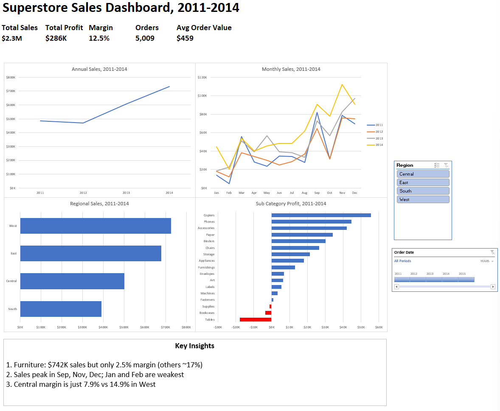
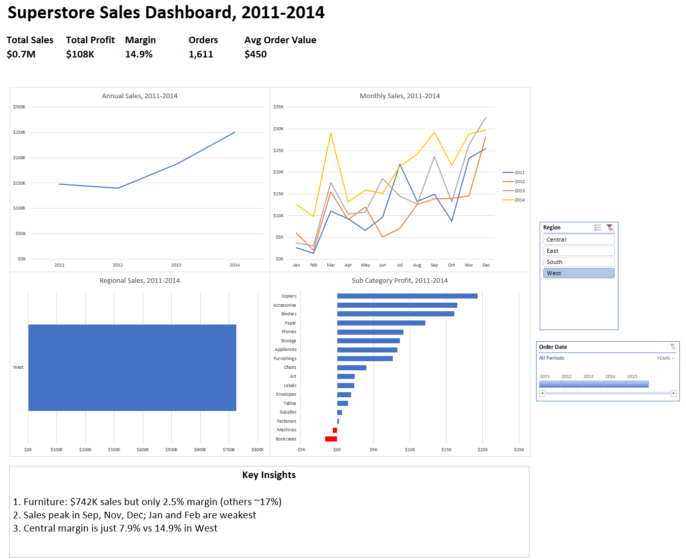

# Superstore Sales Dashboard (Excel)

An interactive Excel dashboard that turns 4 years of US retail sales data (2011-2014) into clear KPIs, trends, and business insights.

## Questions
- Which region has the highest sales? **West ($725K)**
- Which category has the most sales? **Technology ($836K)**
- Which products lose money? **Tables (-$17.7K), Bookcases, Supplies**
- How long does shipping take on average? **3.96 days**

## Dataset and tools
- Kaggle Superstore Sales dataset: 9,994 rows, 21 columns
- Microsoft Excel: Tables, PivotTables, PivotCharts, Calculated Fields, GETPIVOTDATA, Slicers, Timeline

## What I did
- **Cleaning:** kept the raw data untouched, worked on a copy, and checked dates with a Ship Days column
- **Analysis:** used pivot tables to compare sales, profit, margin, and discount by region, category, and sub-category
- **Trends:** grouped dates by year and month to find year-on-year growth and seasonality
- **KPIs:** Total Sales, Profit, Margin, Orders (unique orders, not rows), and Average Order Value
- **Dashboard:** 4 charts and 5 KPIs, with a Region slicer and a date Timeline that filter everything at once

The same dashboard filtered to the West region:

## Key insights
1. Furniture: $742K sales but only 2.5% margin (others ~17%)
2. Sales peak in Sep, Nov, Dec; Jan and Feb are weakest
3. Central margin is just 7.9% vs 14.9% in West

## Recommendations
- **Cut discounts on loss-making sub-categories**, starting with Tables (26% average discount, -$17.7K profit) and Bookcases.
- **Run promotions in January and February**, the weakest months, without deep discounts so margins stay healthy.

## Files
- [`superstore.xlsx`](superstore.xlsx): the workbook (Dashboard, Pivots, Working data, Raw data, Notes)
